# Bike Radar

**Radar alerts you don't have to look for.** Bike Radar is a free,
open-source Android app that draws your rear bike radar as a live overlay
with audio alerts, on top of whatever else is on your screen. As far as we
know it's the only open-source app of its kind. No account, no ads, no
tracking.

[](../../actions/workflows/ci.yml)
[](../../releases/latest)
[](./LICENSE)
[](#requirements)

<a href="https://f-droid.org/packages/es.jjrh.bikeradar/"></a>

You can also **[⬇ download the latest APK](../../releases/latest)**, or add the repo to
[Obtainium](https://github.com/ImranR98/Obtainium) for automatic updates.

Built and ridden daily by the author for months on a Garmin Varia RearVue
820 - a commute tool, not a demo. It works with Garmin Varia radars over
Bluetooth LE: everything on the 820, range only on the earlier models (see
[device compatibility](#compatibility)). Not affiliated with or endorsed by
Garmin.

<p align="left">
  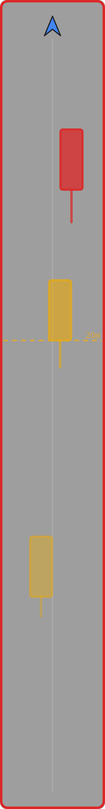
</p>

That strip is the whole of what the app draws. You are the arrow at the
top and each vehicle behind you is a box below it, placed by distance and
by which side it is on, coloured by how much it needs watching. The
dashed line is the alert distance you set: a vehicle beyond it is drawn
and stays silent. The red border marks a vehicle closing fast, and a
radar that reports range only cannot raise it at all. It beeps as a car
closes in behind you, the tier rising as it gets nearer. By default
another car near you gets its own beeps too, and you can turn that off. A
distinct urgent tone fires if an impact looks imminent. The rest of your
screen stays yours.

*¿Hablas español? Hay un resumen [en español](#en-español) más abajo.*

## What it does

- **Radar overlay on any app.** A thin strip shows each vehicle behind
  you: distance, closing speed, and which side it's on. It stays on
  screen whatever else you are running.
- **Alerts you don't have to look at.** Beeps rise in tiers as a car
  nears. Another car near you gets its own beeps too. This is on by default,
  and you can turn it off. A distinct urgent tone fires if an impact looks
  imminent, and a clear chime sounds when the radar sees nothing left within
  your alert distance.
- **Close-pass counting and ride history, all on your phone.** Counts
  the close overtakes the radar actually measured, notifies a post-ride
  summary, and keeps per-ride stats - distance, overtakes, close passes, how
  close and how fast the closest came - in the app's own folder on the phone.
  No account, no location, no route.

<details><summary><b>More features</b></summary>

- Home Assistant integration via MQTT discovery: radar and dashcam
  batteries, front-light mode, close-pass event entity, and a ride summary
  updated every minute during the ride (start time, distance, overtake and
  close-pass counts, the close-pass rate, closing speeds, lateral
  clearances, time with traffic behind you, alerts per km and per hour, and
  the tightest pass: time, side, vehicle size, clearance, closing speed and
  distance behind).
- Front-camera light auto-mode: picks Day Flash before sunset, Night
  Flash after, computed from your location. Grant approximate location, or
  enter coordinates manually if you'd rather not (London fallback if you do
  neither). A manual button press during the session wins for the rest of
  the ride.
- Radar tail-light auto-mode: sets the rear radar's tail light to a day
  mode (default Day Flash) before sunset and a night mode (default Night
  Flash) after, from the same device location. Sets the mode by type, so
  it leaves your radar's button-cycle configuration untouched; a manual
  button press wins for the rest of the ride. Off by default.
- Bosch eBike data (read-only), while Bosch Flow is connected to the bike:
  shows the bike's battery and connection status on the home screen. Its speed
  sets the beep timing and drives the no-radar warning, and the bike's own
  stopped signal tells the app when you have stopped. Its lock state feeds the
  walk-away alarm and a reminder if you walk off without locking it, and, with
  the stopped signal, marks ride start and end for Home Assistant if you use
  it. Cadence, rider and motor power, assist mode and the bike's own distance
  count go only into the capture log, which is off by default. Never sends a
  command to the bike.
- Walk-away alarm: if the radar goes off and the phone still picks up the
  dashcam, the phone sounds its alarm at full volume and vibrates. It waits a
  time you set, 30 seconds by default. It repeats every 5 minutes until you
  dismiss it. It stops if the radar comes back or the phone stops picking up
  the dashcam. With eBike data on and Bosch Flow running, it stays quiet if
  the bike was unlocked when the radar dropped. If the radar's own alarm
  sounds, this one stays quiet, and the radar's alarm names the dashcam if
  the phone was picking it up.
- Radar left on: if you walk away with the radar still on, the phone sounds
  the same alarm once. Works with the radar alone. It learns your radar
  first: it can sound only after the phone has seen your radar switched off
  3 times, and 3 more after each system update or change of radar. It stays
  quiet if the radar drops while you ride or in the 30 seconds after you
  stop, or if its battery is below 10%. With eBike data on and Bosch Flow
  running, it also covers walking off straight after locking the bike, and
  stays quiet if the bike was unlocked when the radar dropped. A radar that
  reports range only never gets it. The alarm is on by default. Turn it off
  in **Settings → Alerts**, under Walk-away alarm.
- No-radar warning: with a Bosch eBike, the app notices when you ride with no
  radar connected. Once the bike has shown you riding for 90 seconds, you hear
  the drop alert (three low pulses), up to three times a ride. A banner on the
  overlay asks whether the radar is on. If it is, another app or device may be
  holding it. An idle reconnect interval over 50 seconds makes it wait longer.
  It needs eBike data switched on and Bosch Flow connected to the bike.
  Turn the warning off in **Settings → Alerts**, under Connection.
- Radar sharing (off until you allow it): another app on the phone can ask
  to read your radar stream, and to change your tail light and hide the
  overlay. It gets nothing until you say yes on a screen naming it. Stop it
  any time in **Settings → Apps allowed to use your radar**. The handover
  happens on this device, app to app, not over the network and not through
  the developer. What the other app does with it afterwards is up to that
  app, so only allow one you trust.
- Optional per-ride capture log (off by default; enable on the Debug
  screen) written to the app's own folder on the phone: radar packets, BLE
  characteristic notifications, eBike telemetry from Bosch Flow,
  phone-battery trace, turn direction and rate from the motion sensors,
  the start and end of a call while another app has the overlay hidden,
  and decoder events; useful for post-ride replay and bug reports. A
  second toggle extends the log back to the start of each connection, for
  a radar that never connects; that adds the connection steps and your
  radar's hardware identifiers, including its serial number.

</details>

## Compatibility

| Your radar | Works? |
|------------|--------|
| Garmin Varia RearVue 820 | ✅ Everything - tested daily |
| Garmin Varia RTL515 / RTL516 | ⚠️ Range only, expected (one report of no connection before 1.4.0) |
| Garmin Varia RVR315 | ⚠️ Range only, expected (unconfirmed) |
| Garmin Varia RCT715 / RCT716 | ⚠️ Range only, expected (unconfirmed) |
| Garmin Varia eRTL615 | ⚠️ Range only, expected (unconfirmed) |
| Garmin Varia RTL510 and older | ⚠️ Range only at best (unconfirmed); an ANT+-only unit cannot connect |
| Non-Garmin radars (Wahoo, Bryton, Magene, Trek, ...) | ❌ No - [why](COMPATIBILITY.md) |

**Why only the 820 gets everything.** The overlay needs each vehicle's
lateral position, closing speed and size. Garmin announced those as new on
the RearVue 820. Earlier radars are not expected to send them at all. On
those the app reads the older range-only stream instead. You get the
approach beeps, the all-clear, and overlay colours that show distance
instead of speed. You do not get the urgent warning, close-pass counting or
the alarm for a radar left on.
With a Bosch eBike, eBike data switched on and Bosch Flow running, the sound
when the radar drops works from the bike, as before. Otherwise it is expected
to fire only if the radar was still seeing traffic behind you shortly before
the link died, because the radar cannot report your own speed and recent
traffic is what tells the app you are still riding; on an empty road it stays
silent. **Settings → Experimental** is where
you set how far back it looks for that traffic, from 30 seconds out to an hour,
or turn the stand-in off. A longer look-back is what makes the sound reachable
on a quiet road, and it also makes it likelier to sound when you park somewhere
busy. No setting above the 30-second default has been measured against real
rides. That fallback is new in 1.4.0 and nobody has confirmed it on real
hardware yet.

Riding anything but an 820? A works or doesn't-work
[report](../../issues) is the most valuable thing you can send. The Debug
screen records what your radar offered, which makes it far more useful. If
the app does not spot your radar by name, pick it during setup or in
**Settings → Radar**.
Front camera, eBike, Android versions and the reason behind each row are in
[`COMPATIBILITY.md`](COMPATIBILITY.md).

## App screens

<p align="left">
  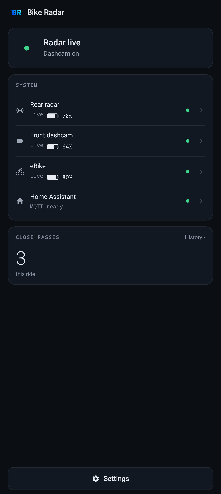
  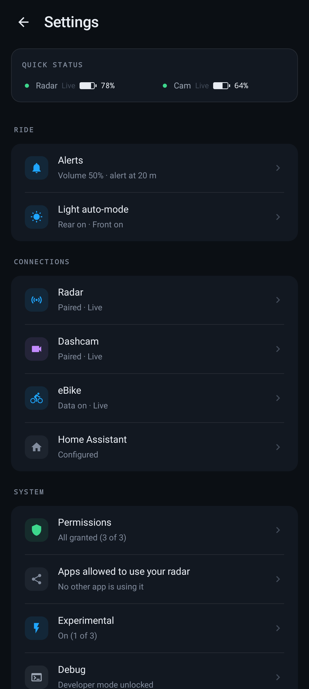
  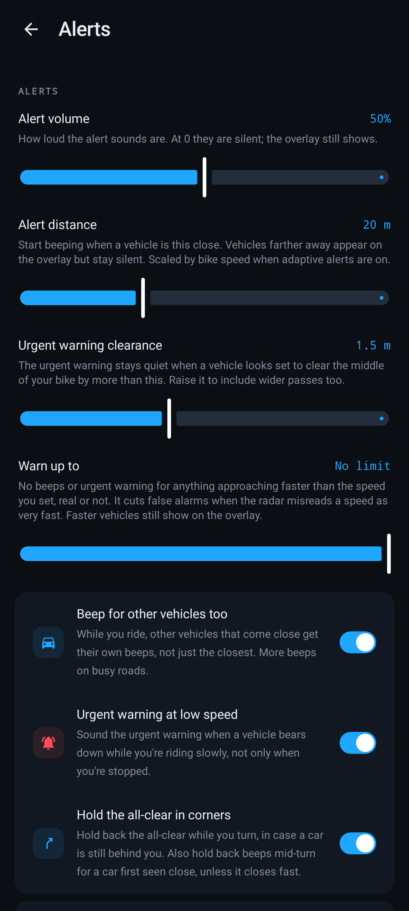
  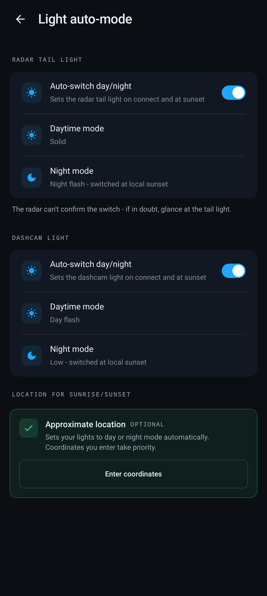
  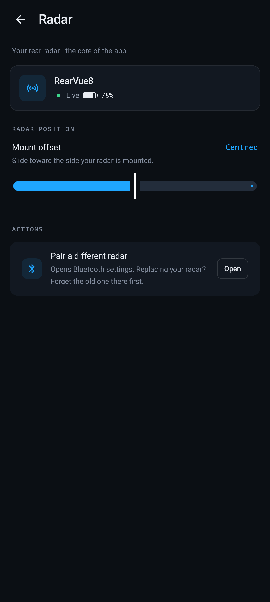
  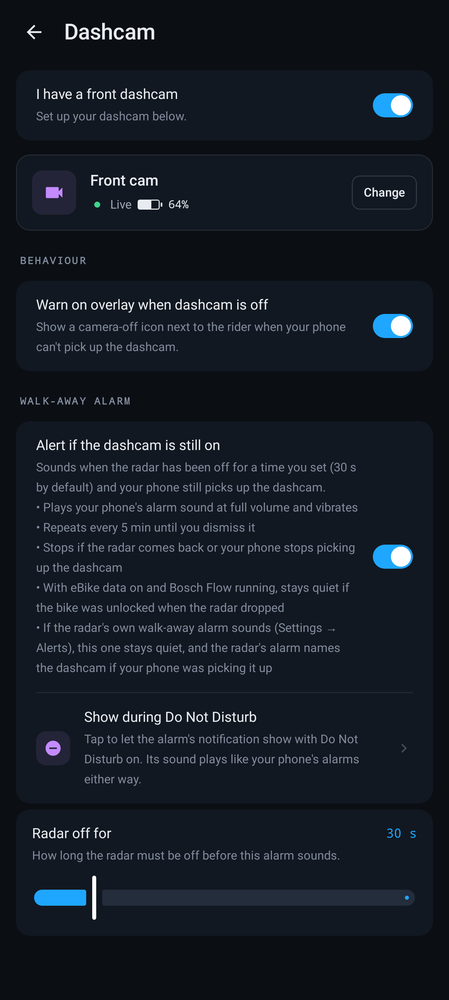
  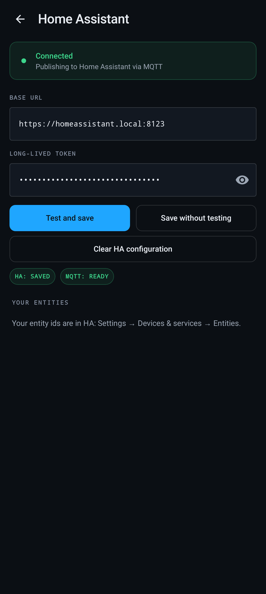
  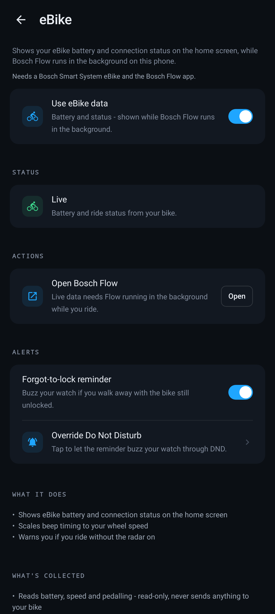
  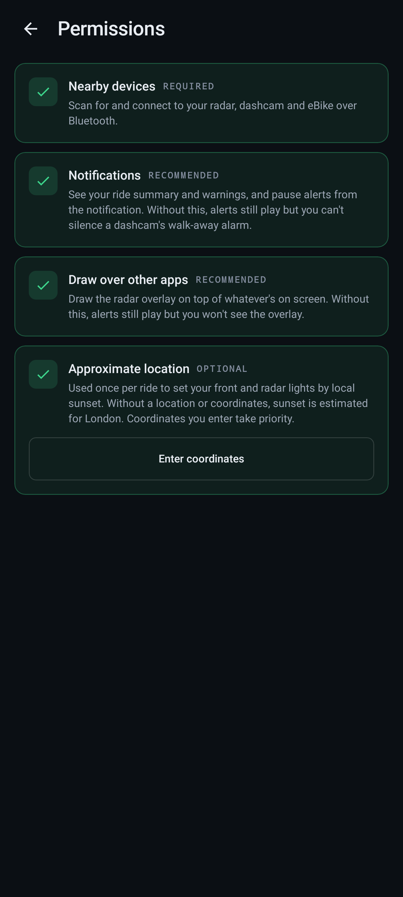
  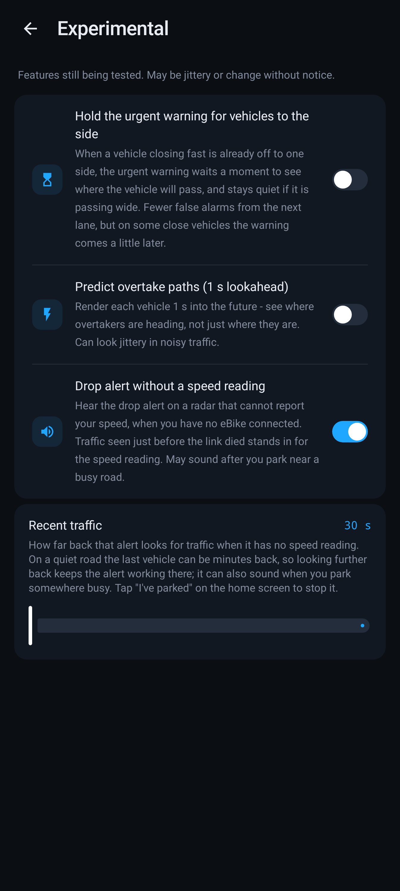
  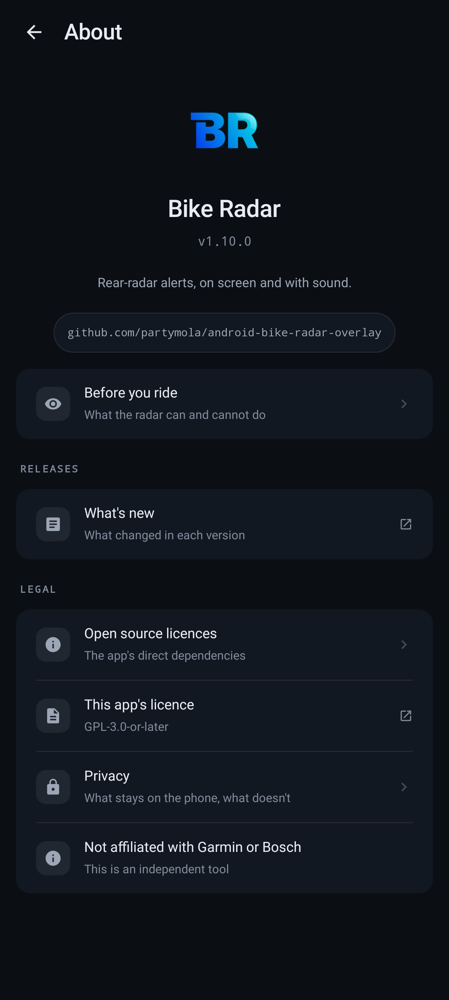
  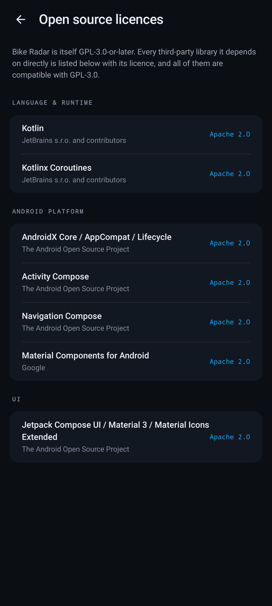
  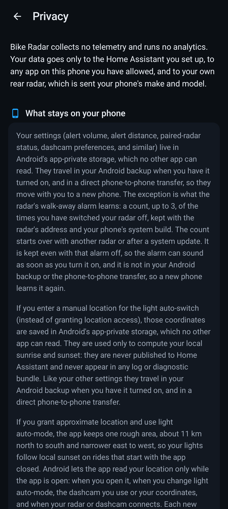
</p>

Debug screen is hidden behind a three-tap long-press unlock on the app title.

## Install

Install it from [F-Droid](https://f-droid.org/packages/es.jjrh.bikeradar/).
F-Droid builds the app from this source and checks it matches the signed APK
before publishing. Signed APKs are also attached to every
[GitHub Release](../../releases). F-Droid and GitHub ship the same signed APK,
so you can switch between them without uninstalling. A new release can take a
few days to reach F-Droid.

For automatic updates from GitHub, add this repository to
[Obtainium](https://github.com/ImranR98/Obtainium): paste the repo URL into
*Add App*.

Store-listing metadata lives under `fastlane/metadata/android/`
(en-US + es-ES) in the standard fastlane structure that catalogues read.

## First run

1. Read the "Before you ride" screen and tap through it. It appears once,
   on your first launch or the first time another app asks to use your
   radar, whichever comes first.
   It is also under **Settings -> About** whenever you want it.
2. Play the example ride to hear the traffic alerts and what they mean.
   Riders past onboarding find it under **Settings -> Alerts -> Alert sounds**.
3. Play a test sound and set the alert volume. Riders past onboarding find it
   on the same Alert sounds page.
4. Grant Nearby devices (Bluetooth scan and connect), which the radar needs.
   Notifications and the overlay are recommended, and approximate location
   for the lights is optional.
5. Enter your Home Assistant base URL and long-lived token (or skip).
6. Pair your rear radar via Android's **Settings -> Connected devices ->
   Pair new device** while the radar is in pair mode. The app detects
   the bond automatically and starts tracking. If it doesn't recognise
   your radar by name, pick it from your paired devices on the same setup
   step, or later in **Settings -> Radar**.

## Requirements

- Android phone (tested on Pixel 10 Pro XL / Android 16). `minSdk = 31`,
  `targetSdk = 36`.
- A rear radar from the Garmin Varia BLE family (see
  [`COMPATIBILITY.md`](COMPATIBILITY.md)) speaking the V2 (bonded)
  protocol. V2 requires a one-time LE Secure Connections pair via
  Android's own Bluetooth settings; the app does not attempt
  `createBond()` itself. A radar whose service table has no V2
  characteristic at all can fall back to the legacy cleartext stream, which
  carries range and nothing else: proximity beeps and the all-clear work,
  the urgent warning and close-pass logging cannot. A radar that does have
  the V2 characteristic never gets the legacy subscribe, whatever the
  handshake does.
- Optional: Home Assistant for battery reporting and pushing close-pass
  and ride-summary events off the phone. See below for the bare-minimum
  HA-side set-up; the overlay, close-pass counting and ride history all
  work standalone without it.

## Home Assistant prerequisites (optional)

If you want the app to push radar + dashcam battery and close-pass
events into HA, the HA side needs:

1. An MQTT broker reachable from HA - e.g. the official
   [Mosquitto add-on](https://www.home-assistant.io/integrations/mqtt/)
   on HA OS / Supervised, or any external broker.
2. HA's MQTT integration enabled and connected to that broker
   (**Settings → Devices & Services → Add Integration → MQTT**).
3. A long-lived access token for the account you want the app to
   act as (**user profile → Security → Long-lived access tokens**).

No extra configuration is required beyond that - the app publishes
via MQTT Discovery on HA's default `homeassistant/` prefix, so
entities appear automatically. Dashboards, automations and
Grafana/InfluxDB are up to you.

If the MQTT broker or the MQTT integration is missing, the app's pushes are
silently dropped. "Test and save" in Settings and "Test connection" in setup
both catch a missing integration, but not a broker that is down behind a
working one, since HA still accepts the publish.

## Troubleshooting & FAQ

**The radar shows as disconnected while I'm using the manufacturer's
app.** That's expected. The radar accepts one Bluetooth connection at a
time, so while the vendor's own app (for firmware updates, settings, or
registration) holds the link, this app cannot connect and shows the
radar as dropped. Finish in the vendor app - firmware updates in
particular should never be interrupted - then close it, and this app
reconnects on its own within a few seconds.

**I didn't ride for a few months and now the app is dead.** Android
automatically pauses apps you haven't opened in a while and revokes
their permissions ("app hibernation"), which silently stops the radar
service from starting. Before a long break - or after one, if the app
stopped working - open the app once, and if Android asks, disable
"Pause app activity if unused" for it under **System settings → Apps →
Bike Radar**.

**The app logged a close pass at 08:14:32 - how do I get the camera
clip?** The app never touches the camera's footage. Use the timestamp
from the ride history (or the close-pass event in Home Assistant) to find
the moment, then pull the clip the way your camera vendor supports - their
app's media gallery, or the camera's USB/SD storage directly. Camera
clocks can drift a few seconds from the phone's; scrub around the
timestamp.

**I hear every alert twice with Bluetooth headphones.** With a Bluetooth
headset connected, the phone may also play each alert on its own speaker. The
copy in your headset then arrives a moment later. So far this has been seen on
one phone, and the cause is not known yet. If it happens to
you, a [bug report](../../issues) saying whether the phone's speaker also
sounds would help.

**What happens to my data on a new phone?** Your settings - including
the Home Assistant URL and token, and the list of apps you have allowed
to use your radar - are part of your Android backup
(encrypted by Android with your screen lock) and the new-phone transfer
wizard (a direct phone-to-phone copy that never touches a server), so
the app comes up configured on the new phone. Four things don't
transfer: the radar pairing (Bluetooth bonds belong to the system;
re-pair once in Android's Bluetooth settings), the rough area the light
auto-mode uses (the app reads it again when you first open it on the new
phone), what the walk-away alarm has learned about your radar (it needs to
see the radar switched off 3 times again before it can sound), and the
files in the app's own folder: ride history, capture logs, crash reports,
the connection log and periodic screenshots (the app
deliberately excludes them from backups; for long-term ride stats off the
phone, the Home Assistant integration is the supported path).

## Status

Stable. Feature-complete and ridden daily by the author for months,
tested on a Garmin Varia RearVue 820 and a Pixel 10 Pro XL. Every other
Garmin Varia radar is expected to work range-only at best, and an
ANT+-only unit will not connect at all. None of that is
confirmed on real hardware yet, so if yours works, or doesn't, a quick
[report](../../issues) is genuinely useful. Behaviour on other phones,
radars and future firmware may still differ. Bug reports welcome; please
include device, Android version and radar firmware.

## Known limitations

The radar and the app can both miss things. These are the ones worth
knowing before you rely on it.

- **A vehicle can go unseen.** The radar has a limited field of view and
  range, and it can lose a vehicle it was following. Nothing further down
  can report what the radar never saw.
- **A warning can come late.** Alerts are worked out from what the radar
  reports moment to moment, so a vehicle that arrives close and fast can be
  announced with little warning.
- **The link and the sound can drop without telling you.** Bluetooth can
  disconnect mid-ride, and another app can take the audio. There is an
  alert for a dropped radar, and it has limits of its own (see
  [compatibility](#compatibility)). With a Bosch eBike there is also one for
  riding with no radar connected. It needs eBike data switched on and Bosch
  Flow connected to the bike, and it stays quiet while you pause alerts.
- **The ordinary beeps stop while you are stopped.** After a couple of
  seconds at a standstill the tier beeps are suppressed, while the urgent
  tone and the all-clear chime still sound. That is deliberate, so a queue at
  a red light does not beep at you, but it means a car rolling up behind you
  while you wait is silent unless it is closing fast enough to count as
  urgent. It needs a speed reading to know you have stopped, so a range-only
  radar with no eBike never suppresses anything.
- **Alerts go quiet during a phone call, and while you pause them.** The
  overlay keeps drawing through a call. The sound does not.
- **"All-clear" means the radar sees nothing.** It does not mean the road
  behind you is empty, and it does not mean it is safe to move out.

Always look behind before you manoeuvre.

## Use at your own risk

This app displays rear-radar information intended to supplement, not
replace, rear observation. It is not a replacement for a rear-view
mirror, direct observation, or safe riding practice. Treat anything
shown on the overlay as advisory only, and never rely on it alone for
safety-critical decisions. Always shoulder-check before manoeuvring.

The optional eBike status feature is read-only: it passively listens to
data your Bosch eBike already broadcasts while the Bosch Flow app is
connected, and never sends any command to the bike.

The GPL-3.0 licence (see `LICENSE`) disclaims warranty to the extent
permitted by applicable law. Not affiliated with or endorsed by
Garmin or Bosch.

## En español

**Bike Radar** es una app de Android que te avisa del tráfico que tienes
detrás usando el radar trasero de tu bici. Dibuja una barra lateral en el
borde de la pantalla, encima de cualquier app que tengas abierta, y pita
cuando se acerca un coche. El número de pitidos
aumenta según se aproxima. Por defecto también pita por otro coche cercano, y
puedes desactivarlo. Suena un aviso distinto si el
impacto parece inminente.

La app está totalmente traducida al español. Si tu teléfono está en español,
Bike Radar se mostrará en español automáticamente. Si prefieres usar solo
esta app en español con el teléfono en otro idioma, puedes hacerlo desde los
ajustes de idioma por aplicación de Android (Android 13 o posterior).

<p align="left">
  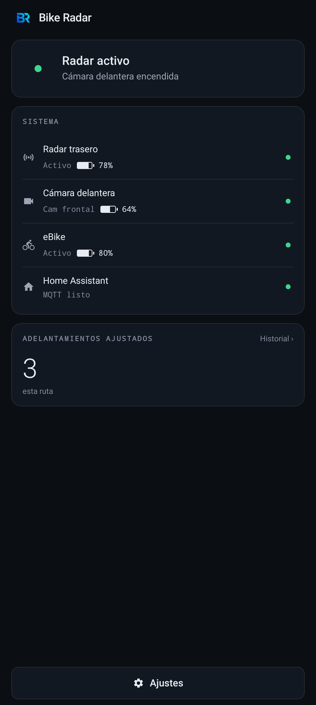
</p>

### Funciones principales

- Radar en pantalla con la distancia, la velocidad de aproximación y la
  posición lateral de cada vehículo; pitidos que suben de nivel, también por
  otro vehículo cercano (se puede desactivar), y un aviso urgente distinto
  para impacto inminente.
- Recuento de adelantamientos cercanos e historial de rutas en el teléfono,
  sin necesidad de Home Assistant: cuenta en la pantalla de inicio los que el
  radar llega a medir y guarda un historial por ruta (distancia,
  adelantamientos totales y cercanos, y a qué distancia y velocidad pasaron
  los más cercanos), sin ubicación ni recorrido.
- Integración opcional con Home Assistant por MQTT: batería del radar y de la
  cámara delantera, modo de la luz delantera, eventos de adelantamiento
  cercano y un resumen de la ruta que se actualiza cada minuto durante la ruta
  (hora de inicio, distancia, número de adelantamientos totales y cercanos,
  porcentaje de cercanos, velocidades de aproximación, holguras laterales,
  tiempo con tráfico detrás, avisos por km y por hora, y el adelantamiento más
  cercano: hora, lado, tamaño del vehículo, holgura, velocidad de aproximación
  y distancia por detrás).
- Luz delantera y luz trasera del radar en modo automático según el
  atardecer local.
- Datos de la eBike Bosch (solo lectura), mientras Bosch Flow está conectado a
  la bici: la pantalla de inicio muestra la batería y el estado de conexión.
  Con la velocidad, la app ajusta el ritmo de los pitidos y activa el aviso de
  radar sin conectar, y la bici le indica cuándo estás parado. Según esté
  bloqueada o no, ajusta la alarma al alejarte, te avisa si te alejas sin
  bloquearla y, si usas Home Assistant, marca allí, junto con la señal de
  parada, el inicio y el fin de la ruta. La cadencia, la potencia, el modo de
  asistencia y la distancia que cuenta la propia bici solo van al registro de
  capturas, que está desactivado por defecto. Nunca envía órdenes a la bici.
- Alarma al alejarte: si el radar se desconecta y el teléfono sigue
  detectando la cámara delantera, el teléfono hace sonar su alarma a todo
  volumen y vibra. Espera el tiempo que elijas, 30 s por defecto. Se repite
  cada 5 min hasta que la descartes. Se detiene si vuelve el radar o el
  teléfono deja de detectar la cámara. Con los datos de la eBike activados y
  Bosch Flow en segundo plano, no suena si la bici estaba sin bloquear cuando
  se cortó el radar. Si suena la alarma del radar, esta no suena, y la del
  radar nombra la cámara si el teléfono la estaba detectando.
- Radar sin apagar: si te alejas con el radar aún encendido, el teléfono hace
  sonar la misma alarma una vez. No necesita eBike ni cámara delantera. Antes
  tiene que conocer tu radar: solo puede sonar cuando el teléfono te haya
  visto apagar tu radar 3 veces, y otras 3 tras cada actualización del
  sistema o cambio de radar. No suena si el radar se corta en marcha o en los
  30 s siguientes a parar, ni si su batería está por debajo del 10%. Con los
  datos de la eBike activados y Bosch Flow en segundo plano, también te avisa
  si te alejas nada más bloquear la bici, y no suena si la bici estaba sin
  bloquear cuando se cortó el radar. Un radar que solo mide la distancia no
  tiene esta alarma. Viene activada por defecto. Puedes desactivarla en
  Ajustes → Alertas → Alarma al alejarte.
- Aviso de radar sin conectar: con una eBike Bosch, la app nota si vas sin el
  radar conectado. Cuando, según la bici, llevas 90 s en marcha, suena el aviso
  de desconexión, hasta 3 veces por ruta, y la barra lateral te pregunta si el
  radar está encendido. Si lo está, puede que otra app u otro dispositivo lo
  esté usando. Con un intervalo de reconexión en reposo de más de 50 s,
  el aviso tarda más. Necesita los datos de la eBike activados y Bosch Flow
  conectado a la bici. Puedes desactivar el aviso en Ajustes → Alertas, en
  Conexión.

El radar funciona por sí solo; Home Assistant, la cámara delantera y la eBike
son opcionales.

### Compatibilidad

- **Garmin Varia RearVue 820:** todas las funciones, probado a diario.
- **Otros radares Garmin Varia:** se espera que funcionen, pero solo midiendo
  la distancia. Tienes los pitidos de aproximación y el aviso de «Carretera
  despejada», y los colores de la barra lateral muestran la distancia en vez de
  la velocidad. No tienes el aviso urgente, el recuento de adelantamientos
  cercanos ni la alarma si dejas el radar encendido. Nadie lo ha confirmado
  aún con hardware real. Un radar que solo tenga ANT+ no puede conectarse.
- **Radares de otras marcas** (Wahoo, Bryton, Magene, Trek...): no
  ([por qué](COMPATIBILITY.md), en inglés).

Con un radar que solo mide la distancia, si tienes los datos de la eBike
activados y Bosch Flow en segundo plano, el aviso de desconexión funciona desde
la bici. Si no, se espera que solo suene si el radar seguía viendo tráfico
detrás justo antes del corte, así que en una carretera vacía no suena. En
Ajustes → Experimental, en «Aviso de desconexión sin velocidad», eliges cuánto
tiempo atrás busca ese tráfico (de 30 s a una hora), o desactivas esta
alternativa. Cuanto más tiempo, más probable es que suene en una carretera
tranquila, y también que
suene si aparcas en una zona concurrida. Ningún valor por encima de los 30 s
por defecto se ha medido con rutas reales. Esta alternativa llegó en la
versión 1.4.0 y nadie la ha confirmado aún con hardware real.

Si tu radar no es un 820, lo más útil que puedes enviar es un
[informe](../../issues) diciendo si funciona o no. Puedes escribirlo en español.
Si la app no reconoce tu radar por el nombre, elígelo durante la configuración
o en Ajustes → Radar.

### Instalación

<a href="https://f-droid.org/es/packages/es.jjrh.bikeradar/"></a>

También puedes descargar el APK de la [última versión](../../releases/latest)
o añadir este repositorio a [Obtainium](https://github.com/ImranR98/Obtainium)
para recibir las actualizaciones automáticamente. F-Droid y GitHub publican el
mismo APK firmado, así que puedes pasar de uno a otro sin desinstalar.

Necesitas Android 12 o posterior. El radar se empareja una vez desde los
ajustes de Bluetooth de Android, con el radar en modo de emparejamiento: la app
no lo hace por ti.

### Limitaciones conocidas

Al radar y a la app se les pueden escapar cosas. Esto es lo que conviene saber
antes de fiarte de ellos.

- **El radar puede no ver un vehículo.** Tiene un campo de visión y un alcance
  limitados, y puede perder de vista un vehículo que estaba siguiendo. La app no
  puede avisarte de lo que el radar no ha visto.
- **Un aviso puede llegar tarde.** Los avisos se calculan con lo que el radar
  informa en cada momento. Si un vehículo aparece ya cerca y rápido, el aviso
  puede llegar con poco margen.
- **La conexión y el sonido pueden cortarse sin avisar.** El Bluetooth puede
  desconectarse en plena ruta, y otra app puede quedarse con el audio. El aviso
  de desconexión tiene sus propios límites (mira
  [Compatibilidad](#compatibilidad)). Con una eBike Bosch también hay un aviso
  si vas sin el radar conectado. Necesita los datos de la eBike activados y
  Bosch Flow conectado a la bici, y no suena mientras tienes los avisos en
  pausa.
- **Los pitidos por nivel se callan cuando estás parado.** A los pocos segundos
  de detenerte dejan de sonar, pero el aviso urgente y «Carretera despejada»
  siguen sonando. Es a propósito, para que la app no te pite mientras esperas
  en un semáforo. A cambio, no oirás un coche que se te acerque por detrás
  mientras estás parado, salvo que venga tan rápido que salte el aviso
  urgente. Para saber que estás parado, la app necesita tu velocidad: con un radar que solo mide la
  distancia y sin eBike, los pitidos nunca se callan.
- **Los avisos se callan durante una llamada y mientras los tienes en pausa.**
  Durante la llamada la barra lateral sigue en pantalla, pero sin sonido.
- **«Carretera despejada» solo significa que el radar no ve nada.** No significa
  que detrás no haya nadie, ni que sea seguro abrirte o cambiar de carril.

Mira siempre atrás antes de maniobrar.

### Uso bajo tu responsabilidad

Bike Radar es una ayuda para tus rutas, no una garantía de seguridad.
Complementa tu propia atención y tus espejos; nunca los sustituye. Toma lo que
muestra la barra lateral solo como orientación, y no dependas únicamente de ella para
decisiones de seguridad. La licencia GPL-3.0 (mira `LICENSE`) excluye cualquier
garantía en la medida en que lo permita la ley. No tiene relación con Garmin ni
con Bosch, y ninguna de las dos lo respalda.

## Build

Builds run in Docker so the host only needs `adb`:

```bash
docker build -t bike-radar-builder .
mkdir -p "$HOME/.cache/bike-radar-gradle"
docker run --rm \
  -v "$PWD:/workspace" -u "$(id -u):$(id -g)" \
  -v "$HOME/.cache/bike-radar-gradle:/gradle-cache" \
  -e GRADLE_USER_HOME=/gradle-cache \
  -w /workspace bike-radar-builder \
  ./gradlew assembleDebug --console=plain --no-daemon

adb install -r app/build/outputs/apk/debug/app-debug.apk
```

The first build generates `debug.keystore` at the repo root (gitignored)
and reuses it across rebuilds so `adb install -r` keeps working.

## Releases

Signed APKs are published as GitHub Releases when a tag matching
`v*` is pushed. The release workflow builds from a clean checkout,
signs with a release keystore held as repo secrets, and attaches
the APK to the Release. Releases are published as stable from 1.0.0;
a pre-release cut would flip the `prerelease` flag in the workflow.

To cut a release:

```bash
# Bump versionCode / versionName in app/build.gradle.kts, commit.
git tag vX.Y.Z
git push origin vX.Y.Z
```

The workflow needs these GitHub repo secrets to exist:

- `ANDROID_KEYSTORE_BASE64` - the release keystore, base64-encoded
- `ANDROID_KEYSTORE_PASSWORD` - keystore password
- `ANDROID_KEY_ALIAS` - key alias inside the keystore
- `ANDROID_KEY_PASSWORD` - key password

Local release builds pick the same env variables up from the
shell (with `ANDROID_KEYSTORE_PATH` pointing at the keystore
file on disk) and otherwise fall back to the debug signing config
so the `release` variant can still be built for inspection
without the production key.

## Translating

The UI is fully externalised into Android string resources, so it can be
translated without touching code - Spanish ships in
[`values-es`](app/src/main/res/values-es/strings.xml). To add a language,
fork, create `app/src/main/res/values-<code>/strings.xml`, translate the
text between the tags, and open a PR. Full instructions (placeholders,
plurals, what CI checks) are in [`CONTRIBUTING.md`](CONTRIBUTING.md).

## Contributing & support

Bug reports, ride captures from other radar hardware, translations, and
PRs are welcome - see [`CONTRIBUTING.md`](CONTRIBUTING.md). The project
does not take donations; if you want to help, the most valuable
contributions are a hardware report from a radar the app hasn't seen
before, and protocol corrections in the companion
[`bike-radar-docs`](https://github.com/partymola/bike-radar-docs) repo.

The app speaks the V2 (bonded) BLE rear-radar protocol, and falls back to
the range-only V1 cleartext stream on a radar that exposes no V2
characteristic. See
[`PROTOCOL.md`](https://github.com/partymola/bike-radar-docs/blob/main/PROTOCOL.md)
in the companion repository for the wire protocol, reference decoder,
and unit tests.

## License

Copyright (C) 2026 JJ del Rio. GPL-3.0-or-later, see [`LICENSE`](./LICENSE). Six
cross-app contract files are Apache-2.0 instead, listed below.

### Building an app on top of the radar

Another app on the phone can bind to Bike Radar and, once the rider grants it,
read the radar stream. Two things make that practical, and they answer
different questions.

**The contract is permissively licensed.** Six files are **Apache-2.0**:
`IRadarService.aidl`, `IRadarListener.aidl` and `RadarStateParcel.aidl` under
`app/src/main/aidl/es/jjrh/bikeradar/ipc/`, and `RadarContract.kt`,
`RadarStateParcel.kt` and `RadarVehicleParcel.kt` in the matching package under
`app/src/main/java/`. Copy them into your project and keep your own licence on
the result. Two things travel with them: keep the copyright line, which
Apache-2.0 section 4(c) requires in the source you distribute, and ship
[`LICENSES/Apache-2.0.txt`](./LICENSES/Apache-2.0.txt), which section 4(a)
requires recipients to get. They are self-contained on purpose:
nothing in them reaches back into the app, so together they are a complete
client contract, including the consent screen you send the rider to. Everything
that implements them, and the rest of the app, stays GPL-3.0-or-later.

**Keep them in the `es.jjrh.bikeradar.ipc` package.** AIDL bakes the
fully-qualified interface name into the generated stub and checks it on every
call, so a repackaged copy fails at run time rather than at build time. Calls
you make come back refused with a `SecurityException`. Frames we deliver to your
listener are worse: that interface is `oneway`, so the mismatch throws inside
your process and nothing reaches us, leaving you with a registration that
succeeded and a stream that never arrives. This is the one mistake that survives
your build.

**And on the copyleft question, we grant rather than argue.** An app that
communicates with Bike Radar solely through that interface, and incorporates no
other part of it, is covered by an additional permission under section 7 of the
GPL, set out in
[`additional-permission.txt`](./additional-permission.txt). Write it, ship it
and license it as you please. Nothing about this app requires you to publish
its source.

Reaching past the interface into the rest of the code is a different matter,
and the GPL applies there as it normally would.

**An app already does this.**
[Crazy Capy Randonneur](https://github.com/zingo/Crazy_Capy_Randonneur) is a
long-distance cycling app built to last all day on one charge. Its status bar carries
the radar battery, the overlay toggle and the tail light. It was the first app
built on this interface.
